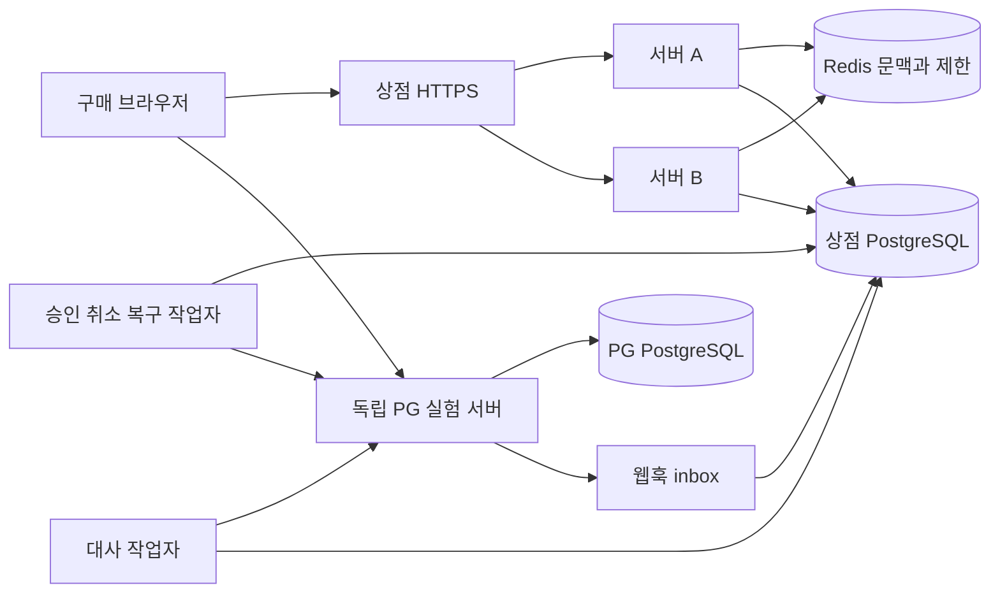
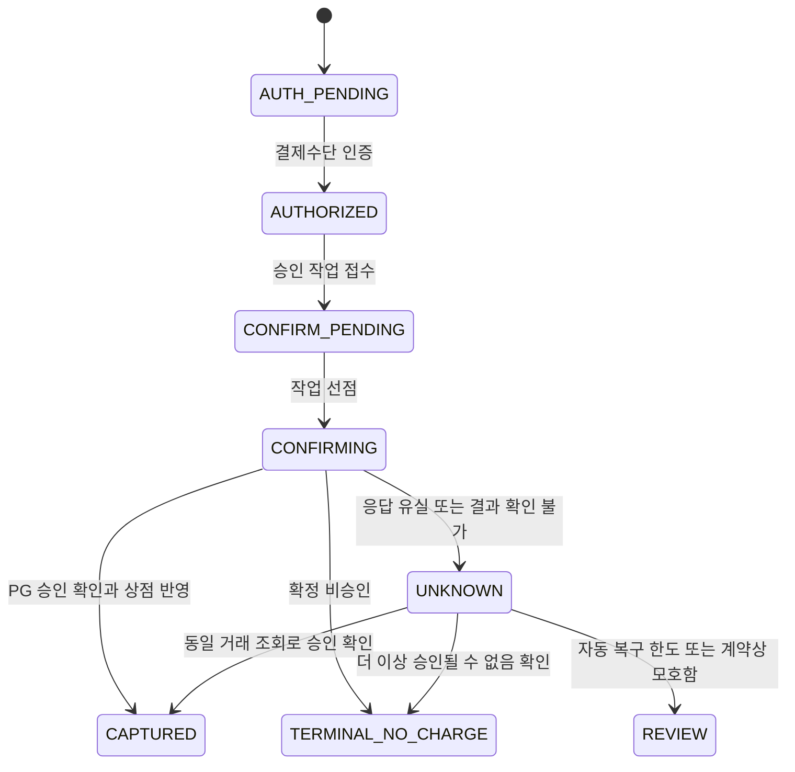

# 결제와 거래 정합성 및 취소와 복구 상세설계

기준일 2026-10-18 KST. 구현 전 설계안. 시간·한도·포트·기술 구성은 이 실험실의 제안값이다. 아래 테스트는 모두 미실행이다.

이 프로젝트는 주문 생성, 결제수단 인증, 승인 요청, 결제사 확정, 상점 DB 반영, 취소와 복구의 경계를 브라우저에서 따라가는 독립 결제 실험실이다. 결제사가 이미 승인했는데 상점이 응답을 잃은 경우를 중심으로 중복 결제 방지와 거래 정합성을 설명한다.

핵심 원칙은 결과를 모르는 상태를 실패로 바꾸지 않는 것이다. 같은 논리 거래의 식별자를 유지하고 결제사 조회와 재처리로 상태를 맞춘다. 상점 DB와 외부 결제사를 하나의 DB 트랜잭션으로 묶을 수 있다고 가정하지 않는다.

이 단계에서는 애플리케이션 소스, DDL, 설정, HTML 화면, 테스트 코드를 작성하지 않는다. 기존 포트폴리오와 로그인·회원가입·게시판·채팅 프로젝트도 변경하지 않는다.

## 1 범위와 결제사 구성

| 항목 | 기본 구현 범위 |
|---|---|
| 주문 | 서버 상품 가격으로 금액 확정, 소유권, 주문 만료, 동일 구매 의도의 주문 중복 방지 |
| 결제 | KRW 일시불 승인, 결제수단 인증과 승인 분리, 확정 실패와 결과 불명 구분 |
| 중복 방지 | 버튼 연타, 새로고침, 같은 키와 다른 키, 두 탭, 서버 A·B 경쟁, 재시도 |
| 거래 정합성 | 금액·통화·주문 대조, 승인·취소 원장, 원자적 상점 반영, 후속 이벤트 중복 제거 |
| 취소 | 전액 취소, 금액 기준 부분 취소, 동시 취소, 취소 응답 유실, 승인 중 주문 종료 요청 |
| 복구 | 실제 네트워크 차단·앱 종료, durable job, 웹훅 재전송·역순, 결제사 조회와 대사 |
| 관찰 | 상점과 결제사 상태 비교, 원장과 예약 금액, 작업 lease, 실행 기록과 실제 소스 연결 |
| 검증 | 실제 상점 백엔드·PostgreSQL·Redis·독립 PG 실험 서버를 사용하는 브라우저 기본 64개 |

기본 결제사는 **별도 프로세스와 별도 DB를 가진 Local PSP**로 둔다. 승인·취소·멱등 처리·조회·웹훅을 실제 HTTP와 저장소로 수행하되 실제 카드망이나 금전 이동은 발생시키지 않는다. 브라우저에서 결제 완료 그림만 바꾸는 모형과 구분한다.

Toss Payments 테스트 환경 연결은 같은 어댑터의 후속 검증 X01~X04로 분리한다. 테스트 키·상점 설정이 준비되면 실제 PG 계약을 검증하며, Local PSP 통과를 실제 PG·카드사 승인이나 운영 결제 검증으로 표현하지 않는다.

정기결제·빌링키, 분리 승인과 매입, 가상계좌, 복합결제·포인트, 배송·상품 회수, 카드사 차지백, 정산·수수료·세금계산서·법정 회계 원장은 기본 범위에 넣지 않는다. 부분 취소는 첫 버전에서 금액 기준이며 상품 수량 반환을 뜻하지 않는다.

## 2 반드시 지킬 규칙

| 규칙 | 판정 기준 |
|---|---|
| 금액의 기준 | 서버가 저장한 주문의 가격·수량·통화 스냅샷. 브라우저 금액이나 성공 URL을 신뢰하지 않는다. |
| 구매 의도 | 같은 checkoutIntent에는 주문 하나. 서로 다른 정상 주문을 사용자·금액이 같다는 이유로 합치지 않는다. |
| 승인 중복 | 한 결제 시도에 승인 작업 하나, 같은 작업에는 같은 PG 멱등 키. 새 클라이언트 키로 우회할 수 없다. |
| 시도 간 경쟁 | 주문당 미해결 결제 시도는 하나. 이전 시도가 결제될 수 없다고 확정하기 전 다음 시도를 열지 않는다. |
| 주문 수락 | 상점이 수락하는 결제는 주문당 하나. 원격의 예상 밖 추가 승인도 실제 금전 사실로 기록하고 격리·보상한다. |
| 거래 사실 | 검증된 PG 승인·취소 거래를 append-only 원장에 한 번씩 반영한다. 과거 행을 성공/실패로 덮어쓰지 않는다. |
| 취소 상한 | 새 취소는 확정 취소액 + 미해결 예약액 + 새 요청액이 승인액 이내일 때만 접수한다. UNKNOWN의 예약 기록은 유지한다. |
| 결과 불명 | 타임아웃·연결 단절·5xx·응답 파싱 실패만으로 미승인·미취소를 확정하지 않는다. |
| 주문 종료 | 승인 여부가 불명확한 주문은 종료 요청 중이다. 늦은 승인을 찾으면 취소로 보상한 뒤 닫는다. |
| 로컬 확정 | 결제·원장·작업 결과·주문 상태·outbox는 상점 DB의 같은 트랜잭션으로 확정한다. |
| 외부 호출 | PG 네트워크 요청 동안 주문/결제 행 잠금과 DB 트랜잭션을 유지하지 않는다. |
| Redis | 요청 제한·인증 문맥·관찰 캐시에만 사용한다. 결제 성공·취소 잔액·멱등 결과의 최종 기준은 DB다. |
| 관찰 | 자동 새로고침이 승인/취소를 재요청하거나 주문·증명·세션 만료를 연장하지 않는다. |

이 설계는 요청 전달 횟수를 한 번으로 보장하지 않는다. PG 멱등 계약, 상점 DB 제약, 거래별 중복 제거로 정상 경로의 금전 효과와 로컬 반영을 한 번으로 수렴시킨다. 다른 시스템·PG 관리 화면에서 생긴 거래도 조회에서 발견할 수 있어야 한다.

## 3 실행 구성과 기존 프로젝트 관계

| 구성 | 역할 |
|---|---|
| React·TypeScript | 주문·결제·취소 서비스, PG 인증 화면 이동, 실제 실행 기록 재생, 데이터와 테스트 탭 |
| Java 21·Spring Boot·Spring Security A·B | 권한·CSRF, 주문/작업 트랜잭션, PG 어댑터, 복구 작업자 |
| 상점 PostgreSQL | 주문·결제 시도·멱등 요청·작업·금전 변동·웹훅 inbox·outbox |
| Redis | 서버 A·B 공통 인증 문맥과 Lua 요청 제한. 금융 상태 캐시로 쓰지 않음 |
| Local PSP | 독립 인증 화면, 승인·취소·거래 조회 API, 별도 금전 효과 기록과 웹훅 재전송 |
| PG PostgreSQL | 상점 DB와 다른 데이터 디렉터리·포트·계정. 상점 장애와 독립적으로 커밋 가능 |
| 검증 | Playwright, 상점/PG DB 직접 대조, 실제 TCP 프록시 차단, 응답 제거, 프로세스 종료 |

예정 프로젝트 이름은 springboot-payment-lab이다. HTTPS 진입 8480, 앱 A·B 8481·8482, Local PSP 브라우저 HTTPS 18480, 내부 서버 18481을 제안한다. 상점 DB 55452/장애 프록시 55453, PG DB 55454, Redis 56489/프록시 56490, 상점→PG 장애 프록시 18482를 분리한다. 구현 착수 때 충돌과 구체 버전을 확인한다.

내부 HTTP는 프로젝트 루프백에만 제한한다. 외부 PG 어댑터는 고정한 HTTPS 출처와 정상 인증서 검증을 사용한다. 전역 TLS 검증을 끄지 않는다. Local PSP의 return URL도 고정 허용 목록으로 제한한다.

기존 로그인과 회원가입 프로젝트의 DB를 직접 공유하지 않는다. 작은 인증 어댑터로 실습 사용자 A·B와 운영 관찰자를 구분하고, 서버의 accountId를 주문 소유자로 사용한다. 로그인 구현을 다시 확장하지 않으며 실제 통합은 별도 어댑터 범위로 남긴다.

## 4 화면 구성

데스크톱은 서비스·처리 흐름과 소스·상점/PG 데이터의 세 영역, 모바일은 서비스·PG·흐름·데이터·검증 탭으로 구성한다. 모바일에서는 선택한 패널만 표시한다.

| 화면 | 입력과 표시 | 동작과 예외 |
|---|---|---|
| 주문 시작 | 서버 상품, 수량, 고정 가격, 구매 의도 ID | 주문 생성. 별도 새 주문은 명시적으로 시작한다. |
| 결제 준비 | 주문번호, 금액·통화, 만료, 현재 시도 | 결제창 열기. 미해결 시도가 있으면 기존 상태로 복귀한다. |
| Local PSP 인증 | 주문 금액, 실습 결제수단, 인증 성공/거절/취소 | 별도 출처. 카드번호·CVC를 직접 수집하지 않는다. 인증만으로 승인하지 않는다. |
| 인증 후 승인 확인 | 서버가 대조한 주문·금액, 결제 확정 | callback GET은 상태를 수집하고 깨끗한 URL로 이동한다. 명시적 POST로 승인 작업을 만든다. |
| 결제 처리 중 | 작업 ID, 승인 대기·호출 중·결과 확인 중, 최근 관찰 | 202는 접수. 새 키 결제 대신 기존 결과 확인·같은 요청 재전송을 제공한다. |
| 결제 완료 | 승인액, 취소액, 남은 금액, 승인 시각, 주문 수락 여부 | PG 확정과 상점 반영이 모두 확인된 상태. 카드사 최종 정산 완료로 표현하지 않는다. |
| 확정 실패 | PG의 확정된 거절 사유, 재결제 가능 여부 | 이전 시도의 비승인이 종결된 경우에만 명시적으로 새 시도를 생성한다. |
| 취소 요청 | 현재 잔액·예약액, 전액/부분 취소, 금액·사유, 마지막 상태 버전 | 서버에서 금액을 다시 판정한다. 취소 중이면 다른 취소를 잠근다. |
| 취소 결과 불명 | 요청액, 미해결 예약액, 확정 취소액, 결과 확인 | 예약액을 성공 취소액처럼 보여주지 않는다. 불명 요청을 새 키로 취소하지 않는다. |
| 주문 종료 요청 | 사용자 종료/만료, 승인 확인·보상 취소 진행 | 돈이 남았는지 모르는 동안 주문 취소 완료로 표시하지 않는다. |
| 거래 내역 | 승인과 부분/전체 취소 각각의 행, 현재 합계 | 원본 승인액을 덮어쓰지 않고 변동 이력을 누적한다. |
| 대사와 복구 | 상점 합계, PG 합계, 차이, 마지막 조회, 자동 복구/검토 필요 | 실제 조회가 성공한 시점만 비교한다. 통신 불가를 잔액 0으로 표시하지 않는다. |

### 처리 흐름과 소스 패널

브라우저 → 서버 → Redis 제한 → DB 접수 커밋 → 작업 선점 → PG 전송 → PG 커밋 → 상점 반영 → 브라우저 결과 순서로 표시한다. 취소에서는 예약 생성, PG 취소 확정, 예약 해제와 원장 반영을 구분한다.

PG 응답 유실 시 PG 노드는 성공하고 상점 노드는 결과 불명인 장면을 보여준다. 웹훅 수신·저장·재조회·상점 반영도 별도 단계다. 전송 시작 이벤트만으로 PG에 요청이 도달했다고 표시하지 않는다.

실제 실행은 완료된 이벤트 재생, 설계 예시는 미리보기로 표시한다. 단계 선택·일시 정지·다음·마지막·재생과 데이터 스냅샷을 연동한다. 구현 후 고정 커밋의 파일·행·발췌·SHA-256을 승인 접수, PG 호출, 반영, 취소 예약, 웹훅, 대사 단계에 연결한다. 현재 역할 이름을 이미 존재하는 소스로 표시하지 않는다.

## 5 금액과 상태 모델

첫 버전은 KRW 정수 원 단위, 주문 총액 1~1,000,000원, 상품 수량 1~10을 제안한다. 금액은 Java long/DB bigint로 처리하고 합계의 범위·오버플로를 검증한다. 부동소수점, 음수·0 취소, 승인 통화와 다른 취소는 거부한다.

주문 생성 시 상품명·단가·수량·총액·통화를 저장하고 고정한다. 상품 마스터의 가격이 나중에 바뀌어도 기존 주문은 그 스냅샷을 사용한다. 할인·세금·배송비 재계산은 첫 범위 밖이며 추가 시 별도 버전의 금액 스냅샷으로 확장한다.

### 서로 다른 상태 축

| 대상 | 상태 | 의미 |
|---|---|---|
| 주문 수락 | OPEN → ACCEPTED | 유효한 결제와 기한·종료 의사를 상점 DB에서 검사하고 주문을 수락함 |
| 주문 종료 | OPEN/ACCEPTED → CLOSING → CLOSED, 확정 전액 취소는 ACCEPTED → CLOSED | 종료 요청 뒤 미해결 금전 효과까지 확인·필요한 취소를 마친 상태 |
| 결제 시도 | AUTH_PENDING, AUTHORIZED, CONFIRM_PENDING, CONFIRMING, UNKNOWN, CAPTURED, TERMINAL_NO_CHARGE, REVIEW | PG 인증·승인 단계와 불확실성을 구분함 |
| 승인·취소 작업 | PENDING → IN_FLIGHT → SUCCEEDED/FAILED_FINAL/UNKNOWN/REVIEW | 개별 명령의 실행 상태. UNKNOWN은 최종 실패가 아님 |
| 금전 상태 | NONE, CAPTURED, PARTIALLY_CANCELED, CANCELED | 검증해 저장한 거래 합계에서 파생함 |
| 동기화 상태 | CURRENT, PENDING, UNKNOWN, REVIEW | PG와 상점의 확인 가능 상태. CAPTURED와 UNKNOWN이 동시에 표시될 수 있음 |

취소가 UNKNOWN이면 기존 금전 상태는 CAPTURED인 채 동기화 상태가 UNKNOWN일 수 있다. 화면에는 승인 10,000원, 확정 취소 0원, 취소 결과 확인 중 3,000원을 각각 표시한다.

주문 기한 만료는 결제사가 승인하지 않았다는 증거가 아니다. 상점의 수락 트랜잭션이 DB 현재 시각과 close_intent를 재검사한다. 이미 종료 의사가 있거나 기한이 지났으면 늦은 승인 사실을 기록하되 주문을 수락하지 않고 보상 취소를 만든다. PG approvedAt과 상점 observedAt·committedAt은 각각 보관한다.

### 금전 정합성 공식

| 값 | 정의 |
|---|---|
| 승인액 A | 검증한 승인 변동 합계. 첫 범위에서 결제 한 건당 승인 거래 하나 |
| 확정 취소액 C | 중복 제거한 취소 변동 합계 |
| 미해결 예약액 R | 아직 성공·실패에 대응하지 못한 취소 작업의 보류 금액 합계 |
| PG 기준 잔액 | A - C |
| 새 취소 가능액 | 정상 상태에서 A - C - R. REVIEW 상태에서는 0 |
| 제약 | A ≥ 0, 0 ≤ C ≤ A, R ≥ 0. 정상 상태의 접수 규칙은 C + R ≤ A |

예를 들어 승인 10,000원에서 3,000원 취소를 접수하면 C=0, R=3,000, 새 취소 가능액=7,000이다. 취소가 확정되면 C=3,000, R=0, 잔액=7,000이다. 취소가 불명확하면 C와 R을 그대로 유지한다.

PG 관리 화면 등 외부 경로의 취소가 먼저 발생하여 실제 잔액보다 불명 예약이 커지면 새 취소를 전부 차단한다. 원래 예약을 REVIEW_HELD로 보존하고 실제 취소 사실을 기록한다. 이 예외에서 C+R≤A를 맞추려고 예약이나 금전 사실을 삭제하지 않는다. 해당 예약이 어떤 원격 작업과 대응하는지 확인한 뒤에만 정산·해제한다.

## 6 상점 DB와 PG DB

아래는 논리 테이블 설계이며 실제 DDL은 작성하지 않는다. 모든 실험 데이터는 realm/run으로 격리하되 애플리케이션의 소유권 검사를 대체하지 않는다.

| 상점 테이블 | 핵심 내용과 제약 |
|---|---|
| checkout_intents | 사용자·구매 의도. 같은 사용자/의도에 주문 하나 |
| orders | 소유자, 가격 스냅샷, expires_at, purchase_state, close_intent, accepted_payment_id, version |
| payment_attempts | order_id, 순번, provider_order_id, 인증 거래, 상태. 주문당 미해결 시도 하나를 DB 제약으로 제한 |
| payments | 실제 PG 결제 식별자, 주문/시도, A·C·R, 금전/동기화 상태, version. PG 환경·상점·결제 식별자 조합 유일 |
| payment_operations | CONFIRM/CANCEL/COMPENSATE, 고정 금액·입력 해시, PG 멱등 키·최초 전송·안전 재시도 기한, 상태 |
| idempotency_requests | 사용자·명령 종류·클라이언트 키의 유일 매핑, 요청 HMAC, canonical operation_id |
| cancel_reservations | 취소 작업당 예약 하나, 고정 금액, ACTIVE/REVIEW_HELD/SETTLED/RELEASED. UNKNOWN에서 임의 해제하지 않음 |
| payment_movements | 검증한 CAPTURE/CANCEL 거래의 append-only 행. PG 거래 식별자 유일, 원거래·작업 연결 |
| operation_jobs | 실제 전송/조회 작업, next_attempt_at, lease_until, lease_token, 시도 수, worker_id |
| webhook_inbox | 수신과 처리 상태, 공급자 이벤트 ID 또는 전달 fingerprint, 본문 해시, 재처리 정보 |
| payment_outbox | 결제 반영과 함께 만든 후속 이벤트, aggregate_version, 발행 상태 |
| projection_inbox | 영수증 projection 소비의 이벤트 중복 제거 |
| payment_receipts | 결제 내역 화면용 projection, 마지막 적용 버전. 오래된 이벤트로 잔액을 되돌리지 않음 |
| reconciliation_cases | 상점/PG 관찰 요약, 차이, 다음 확인, REVIEW 사유, 운영자 조치 이력 |
| auth_contexts·audit_events | 실습 인증·최근 재확인·역할, 승인·취소·복구 감사 기록 |

PG DB는 인증 ticket, PG payments, PG operations/idempotency, PG transactions, webhook delivery queue를 보관한다. PG 승인 또는 취소 거래·멱등 결과·웹훅 발송 작업도 PG 자신의 트랜잭션으로 함께 확정한다. 상점은 HTTP 외의 방법으로 PG DB를 읽거나 쓰지 않으며 직접 DB 접근은 테스트 관찰자에게만 허용한다.

orders.accepted_payment_id는 한 번 수락한 결제를 고정하며 전액 취소 뒤에도 지우지 않는다. payments를 무조건 주문당 한 행으로 제한해 예상 밖 추가 승인 사실이 유실되게 만들지 않는다. 같은 주문에 예상 밖 다른 PG 승인이 발견되면 추가 금전 사실을 보관하고 주문 수락은 하나로 유지하며, 확인 가능한 중복 건은 보상 취소하고 모호한 건은 REVIEW로 격리한다.

단일 결제의 금액 범위 CHECK는 0≤C≤A와 R≥0에 적용하고, C+R의 신규 접수 조건은 결제 행 잠금 안에서 판정한다. 외부 취소 충돌 시 실제 거래를 저장하지 못하게 하는 CHECK는 두지 않는다. 원장 합계와 payments 집계는 같은 트랜잭션에서 갱신하고 대사 쿼리로 검사한다. 행 간 합계를 단일 CHECK만으로 보장한다고 설명하지 않는다.

## 7 멱등성과 동시성

### 세 종류의 식별자

| 식별자 | 생성과 수명 | 용도 |
|---|---|---|
| 클라이언트 멱등 키 | 사용자 행동 시작 시 생성, 재전송·복구 때 유지 | 같은 키·입력은 같은 주문/작업. 같은 키의 다른 금액·통화·대상·사유는 409 |
| operation_id | 상점 DB가 논리 명령 접수 시 생성 | 클라이언트 키가 달라도 같은 시도의 승인은 같은 작업으로 연결 |
| PG 멱등 키 | operation_id·명령 종류·상점·환경에 결속해 서버 생성 | 작업자 교체·재시도에도 불변. 승인과 각 취소는 서로 다른 키 |

클라이언트 키는 인증 수단이 아니다. 작업 조회에는 항상 주문 소유권이 필요하다. operation의 PG 계정·환경·키 버전·요청 경로를 고정하여 키 교체나 경로 변경으로 멱등 보장이 달라지는 것도 다룬다.

PG 멱등 키의 보존 기간과 오류 응답 재생은 어댑터 계약이다. Toss의 현재 문서는 키의 유효 기간을 15일로 설명하지만 이를 모든 PG의 영구 보장으로 일반화하지 않는다. Stripe도 키 정리 뒤 재사용이 새 요청이 될 수 있음을 설명한다. 모호한 기존 거래에 새 키를 주어 재승인·재취소하지 않는다. [Toss 멱등 헤더](https://docs.tosspayments.com/reference/using-api/authorization#멱등키-헤더), [Stripe 멱등 요청](https://docs.stripe.com/api/idempotent_requests)

### 잠금과 판정 순서

1. 인증·CSRF·입력 상한을 검사한다. 자기 클라이언트 키에 기존 매핑이 있으면 입력 일치 확인 후 그 작업을 반환한다.
2. 새 명령은 Redis 제한을 통과한 뒤 주문 → 결제 → 작업 순서로 필요한 행을 잠근다.
3. 잠금 뒤 소유자·현재 시도·기한·close_intent·잔액·버전·기존 canonical 작업을 다시 확인한다.
4. 접수 사실과 job, 취소인 경우 예약까지 함께 커밋한다. 이 커밋 전에는 PG에 변경 요청을 보내지 않는다.
5. 작업자가 DB 조건부 UPDATE/lease_token으로 선점하고 커밋한 뒤 외부 요청을 한다.
6. 외부 응답은 새 상점 트랜잭션에서 거래 유일성·현재 상태를 검사해 반영한다.

조건부 갱신과 유일 제약을 최종 기준으로 삼고, SKIP LOCKED는 작업 분배에만 사용한다. 브라우저의 조회·버튼 비활성화·Redis 분산 잠금으로 금융 정합성을 보장한다고 설명하지 않는다. [PostgreSQL 행 잠금](https://www.postgresql.org/docs/17/explicit-locking.html)

작업 lease 만료는 PG 요청 취소를 뜻하지 않는다. 늦게 돌아온 이전 작업자는 lease_token이 바뀌었으면 작업 진행 상태를 덮어쓰지 못한다. 다만 유효한 원격 거래 증거는 같은 거래 반영 경로로 전달하거나 재조회를 요청하여 버리지 않는다. 원격 중복 효과는 PG 멱등 키가 막는다. lease만으로 이전 프로세스의 외부 전송을 차단할 수 있다고 가정하지 않는다.

### 다른 키와 재결제

같은 시도의 같은 승인 입력에 새 클라이언트 키가 오면 기존 승인 작업에 연결한다. 같은 시도에 다른 PG 결제 식별자를 넣으면 409다. 주문의 UNKNOWN·REVIEW 상태에서는 새 시도 생성도 막는다.

이전 시도가 단순히 NOT_FOUND로 조회됐다고 새 시도를 만들지 않는다. 미완료 전송이 없고, PG가 그 시도를 종결 비승인·인증 폐기로 확정하여 더 이상 승인될 수 없다는 어댑터 계약을 만족해야 한다. 확정된 거절 뒤 사용자가 새 시도를 시작하면 새 PG 주문번호를 부여한다. 한 번 승인된 주문은 전액 취소 뒤에도 같은 주문으로 다시 결제하지 않으며 새 주문을 명시적으로 만든다.

## 8 정상 승인 처리

### 주문과 결제수단 인증

1. 브라우저는 상품 ID·수량·checkoutIntent와 멱등 키를 보낸다. 서버가 현재 상품 가격으로 주문 스냅샷을 생성한다.
2. 결제 시작은 소유 주문을 잠그고 기존 시도 유무를 검사해 하나의 시도를 만든다. Local PSP와 교환할 인증 ticket을 작업에 결속한다.
3. 브라우저는 Local PSP 출처에서 실습 수단을 인증한다. 이 단계에는 CAPTURE 거래가 없다.
4. 돌아온 state/ticket과 후보 결제를 서버가 소유 주문·시도에 결속하고 고정 PG 조회로 금액·통화·상점·주문번호·환경을 대조한다.
5. callback GET은 승인 작업을 만들지 않고 일시적인 query를 정리한다. 사용자가 확인 화면에서 결제 확정 POST를 보낸다.

브라우저의 성공 이동은 결제수단 인증 결과에 불과하다. Toss의 승인 API도 인증 후 서버 승인 단계를 별도로 둔다. [Toss 결제 승인 API](https://docs.tosspayments.com/reference#결제-승인)

### 승인 접수와 확정

| 단계 | DB와 외부 처리 | 브라우저 의미 |
|---|---|---|
| 접수 | 입력·소유·기한 검사, CONFIRM 작업·PG 키·job 커밋 | 202 승인 요청 접수 |
| 전송 | 작업 lease 선점 후 PG confirm HTTP | 승인 처리 중 |
| PG 확정 | PG 자신의 승인 거래·멱등 결과·웹훅 작업 커밋 | 아직 상점 성공으로 표시하지 않음 |
| 상점 반영 | 응답/조회 검증, payment·CAPTURE 원장·operation 결과·주문 수락·outbox 원자 커밋 | 승인과 주문 수락 확인 |
| 반환·조회 | 같은 작업의 최종 결과 | 결제 완료. 재조회는 새 승인 없음 |

PG 응답에 주문·금액·통화·상점이 맞지 않으면 주문을 수락하지 않는다. 확인 가능한 원격 이상 거래를 별도 증거로 기록하고 REVIEW 처리한다. 검증 실패를 정상 결제로 보정하거나 자동으로 잘못된 금액만큼 추가 승인하지 않는다.

PG가 승인했지만 상점 반영이 실패하면 작업은 UNKNOWN이고 영속 접수 기록이 남는다. 웹훅 또는 작업자·대사 조회가 같은 원격 거래를 반영하며 payment_movements의 PG 거래 유일성으로 중복 원장을 막는다.

## 9 전액 취소와 부분 취소

### 취소 접수와 금액 예약

1. 본인 결제·최근 인증·CSRF, 취소 사유, 양의 정수 금액을 검사한다. 전액 취소는 요청 시점 잔액을 서버가 계산하여 고정 금액으로 저장한다.
2. 같은 멱등 키의 결과 조회는 현재 버전 검사보다 먼저 한다. 이미 확정한 요청을 버전이 바뀌었다는 이유로 실패시키지 않는다.
3. 새 취소는 주문 → 결제 행을 잠그고 expectedPaymentVersion, PG의 부분 취소 가능 여부, 진행 중 취소, A-C-R을 확인한다.
4. 첫 버전은 결제당 미해결 취소 명령 하나만 허용한다. CANCEL 작업·예약·job을 같은 트랜잭션에 저장하고 결제 버전을 증가시킨다.
5. PG 호출 뒤 취소 거래를 검증해 CANCEL 원장 추가, C 증가, R 감소, 예약 SETTLED, 작업 성공, 주문/내역·outbox를 같은 커밋으로 반영한다.

한도가 10,000원인데 두 탭이 각각 7,000원을 취소하려 하면 첫 요청이 7,000원을 예약하고 나머지는 진행 중/버전 충돌로 거부된다. 같은 금액이라는 이유만으로 서로 다른 취소 요청을 자동 병합하지 않는다.

미해결 취소가 있으면 계산상 잔액이 남아도 첫 버전에서는 다음 취소를 접수하지 않는다. 부분 취소가 확정되고 잔액이 남으면 주문은 ACCEPTED를 유지하며 금전 상태만 PARTIALLY_CANCELED가 된다. 전액 취소가 확정되면 CLOSED로 바꾸고, 직접 취소의 확정 실패는 기존 주문 수락 상태를 바꾸지 않는다. 별도로 이미 접수한 주문 종료 의사는 실패 때문에 지우지 않고 CLOSING/REVIEW에서 계속 확인한다.

화면의 취소 완료는 PG 취소 거래와 상점 반영을 확인했다는 뜻이다. 카드사의 청구 변경이나 구매자 계좌의 최종 환급 완료와 구분한다.

첫 취소가 빠르게 끝나도 이전 화면의 다른 키 요청은 낡은 expectedPaymentVersion으로 거부한다. 사용자가 새 잔액과 버전을 확인한 다음 새 키로 명시 요청하면 별도의 정상 부분 취소다.

Toss의 API는 부분 취소액과 취소 거래별 transactionKey를 제공한다. 실제 어댑터는 부분 취소 가능 여부와 취소 식별 계약을 확인한다. [Toss 결제 취소 API](https://docs.tosspayments.com/reference#결제-취소)

### 결과별 예약 처리

| PG 결과 | 처리 |
|---|---|
| 해당 취소 성공 확정 | 해당 작업의 예약을 정산하고 검증한 취소 거래를 한 번 반영 |
| 해당 취소의 확정 실패 | 예약 해제, 실패 이유 저장. 이후 재시도는 새 사용자 결정으로 시작 |
| 타임아웃·5xx·연결 단절 | UNKNOWN, 예약 유지, 같은 operation/PG 키로 조회·허용된 재시도 |
| 다른 경로의 취소 발견 | 외부 거래 사실을 기록하고 실제 잔액을 재검사. 자기 불명 취소를 금액만으로 성공 판정하지 않음 |
| 예약 포함 제약을 만족시킬 수 없는 충돌 | 새 취소 차단, 불명 예약을 격리해 REVIEW. 실제 거래 사실을 삭제해 집계를 맞추지 않음 |

Local PSP는 operation_id/멱등 키로 작업 결과와 거래 ID를 조회할 수 있게 한다. 실제 PG가 이 계약을 제공하지 않으면 조회한 취소 금액만으로 작업을 대응시키지 않는다. 멱등 응답 재조회·이전 거래 집합·공급자 식별자를 통해 유일하게 대응할 수 있을 때만 예약을 정산하고, 모호하면 REVIEW로 남긴다.

### 승인 중 종료 요청과 보상 취소

아직 PG에 승인 작업이 접수되지 않았다면 종료 의사를 DB에 기록하고 시도 인증을 폐기하여 닫는다. 작업이 접수됐거나 전송될 수 있다면 close_intent를 기록하고 CLOSING으로 둔다. 브라우저 닫기나 타임아웃만으로 승인 job을 삭제하지 않는다.

작업자는 전송 전 종료 의사를 다시 검사한다. 이미 전송 중이었다면 PG 조회로 최종 비승인을 확인하거나, 승인을 발견한 뒤 별도의 COMPENSATE 취소를 만든다. 자동 보상은 원래 권한 있는 주문 종료 의사에 결속하고 별도 PG 멱등 키를 사용한다. 취소가 불명확하면 주문도 CLOSING 상태를 유지한다.

승인과 종료가 경쟁할 때는 상점 주문 행 잠금 순서로 수락 여부를 정한다. 종료가 먼저면 승인 사실이 나중에 도착해도 주문을 수락하지 않는다. 승인이 먼저면 정상 취소 절차로 진행한다. 최종 CLOSED는 관련 미해결 승인·취소가 없고 해당 종료에 필요한 잔액 0을 확인한 경우다.

## 10 웹훅과 후속 이벤트

### Local PSP 웹훅

Local PSP는 raw body HMAC, delivery timestamp, 안정적인 eventId를 제공한다. 수신 서버는 본문 변경·서명·허용 시각·대상 상점·환경을 검사한다. 재전송은 eventId를 유지하고 새 전달 시각과 서명을 사용한다.

유효한 수신은 inbox에 내구성 있게 커밋한 뒤 빠르게 200을 반환한다. 응답이 유실되어 다시 오면 같은 이벤트의 기존 접수를 반환한다. DB 저장이 안 되면 성공 응답을 만들지 않는다. 본문 자체를 결제 확정 증거로 바로 적용하지 않고 PG의 현재 결제와 거래 목록을 조회한 뒤 공통 반영 경로로 보낸다.

### 공급자별 검증과 역순

모든 PG 웹훅에 같은 서명 헤더가 있다고 가정하지 않는다. Toss 일반 결제 웹훅은 결제 조회 API로 교차 확인하는 방식으로 어댑터를 나눈다. 서명이 있는 다른 이벤트의 방식을 일반 결제에 그대로 적용하지 않는다. [Toss 웹훅 검증 구분](https://docs.tosspayments.com/guides/v2/get-started/llms-quick-reference), [Toss 보안 체크리스트](https://docs.tosspayments.com/reference/using-api/security-checklist)

공급자 이벤트 ID가 없다면 전달 fingerprint는 조회 작업을 합치는 힌트로만 사용한다. 금전 반영의 중복 제거는 공급자 거래 식별자가 책임진다. 공개 수신 URL은 엄격한 본문 상한·미등록 대상 처리·요청 상한을 두고 임의 paymentKey만으로 주문을 생성하지 않는다.

취소 웹훅이 승인 웹훅보다 먼저 와도 현재 결제와 전체 거래 목록으로 승인 및 취소 사실을 함께 복구한다. 이벤트 시간·도착 순서·문자열 transactionKey를 정렬한 순서를 금융 상태의 우선순위로 사용하지 않는다. Stripe도 웹훅 순서를 보장하지 않음을 명시한다. [Stripe 이벤트 순서](https://docs.stripe.com/webhooks#event-ordering)

이전 조회 응답이 늦게 도착해도 이미 확인한 취소 거래를 제거하거나 CANCELED를 CAPTURED로 되돌리지 않는다. 승인액 변경, 취소액 감소 등 첫 범위에서 설명할 수 없는 역행은 재조회·REVIEW 대상으로 남긴다.

### 상점 outbox와 영수증 projection

상점의 거래 반영과 payment_outbox는 같은 트랜잭션에 저장한다. 전달은 적어도 한 번이며 소비자는 eventId와 aggregate_version으로 중복·오래된 이벤트를 거른다. 영수증 projection의 갱신 실패가 승인 자체를 실패로 바꾸지 않는다. [AWS transactional outbox](https://docs.aws.amazon.com/prescriptive-guidance/latest/cloud-design-patterns/transactional-outbox.html)

후속 소비자가 결제 완료 이벤트를 늦게 받아도 이미 취소된 내역을 다시 결제 완료로 복원하지 않는다. 배송·이용권 발급은 이 projection 성공과 동일시하지 않으며 후속 업무의 취소 정책과 별도로 설계한다.

## 11 결과 불명과 대사 복구

| 장애 지점 | 상점/PG의 가능한 상태 | 처리 |
|---|---|---|
| 접수 DB 커밋 전 중단 | PG 미호출, 작업 없음 | 롤백. 같은 클라이언트 키로 접수 가능 |
| 접수 뒤 전송 전 중단 | 상점 job 있음, PG 효과 없음 | 다른 작업자가 같은 작업을 선점해 계속 |
| 전송 중 TCP 단절 | PG 도착 여부 불명 | UNKNOWN, 새 키 금지, 같은 거래 조회 |
| PG 커밋 후 응답 유실 | PG 승인/취소 있음, 상점 미반영 | 조회·웹훅으로 반영. 새 금융 명령 생성 금지 |
| PG 확인 뒤 상점 커밋 실패 | 상점에 접수만 남거나 반영 결과 불명 | 상점 DB와 PG를 재조회해 동일 거래 한 번 반영 |
| 상점 커밋 후 브라우저 응답 유실 | 상점·PG 확정 | 본인 주문/작업 결과 조회, 같은 키 재전송 |
| lease 소유 앱 실제 종료 | PG 전송 중일 수도 있음 | lease 만료 후 같은 작업·PG 키로 복구, 이전 작업자 덮어쓰기 방지 |
| Redis 장애 | 새 인증·제한 판정 불가 | 새 승인/취소 503. 이미 접수한 DB 작업자·웹훅·대사는 Redis 없이 계속 |
| 상점 DB 장애 | PG에는 돈이 움직였을 수 있음 | 신규 명령 거부, 웹훅 실패 응답, 복구 후 job·inbox·대사 재개 |
| 웹훅 유실·장기 지연 | PG만 변경됨 | 미해결 작업과 최근 종료 거래의 주기적 대사가 발견 |
| PG 멱등 안전 기한 초과 | 재전송이 새 효과를 만들 위험 | 변경 API 자동 재전송 중단, 조회만 계속, REVIEW |
| 대사 한도 소진 | 확정 여부 불명 | 성공/실패를 추정하지 않고 예약·미해결 기록 유지, 운영자 확인 필요 |

대사는 본인 작업/등록된 PG 결제를 조회하고 주문·상점·환경·통화·금액·거래 식별자를 검사한다. 단일 NOT_FOUND, 네트워크 오류, 이전 캐시만으로 미승인·예약 해제·재결제 허용을 판정하지 않는다.

자동 복구는 누락된 승인/취소 원장 반영, 종결 결과 반영, 안전한 동일 작업 재전송, 권한 있는 종료 의사에 따른 보상 취소까지다. 다른 결제에 결과를 붙이거나 원장 합계를 직접 고치는 관리자 버튼은 제공하지 않는다. 운영자의 재조회·복구 재개에도 역할·사유·감사 기록이 필요하다.

## 12 정책과 자원 상한

| 항목 | 기본 제안값 | 기준 |
|---|---:|---|
| 주문 수락 기한 | 생성 후 10분 | 관찰·재시도로 연장하지 않음 |
| Local PSP 인증 ticket | 5분, 주문 기한 이내 | 소유 시도·금액·return 출처 결속 |
| 취소의 최근 인증 | 5분 | 기존 수단 재확인. 자동 보상은 저장된 종료 의사에 결속 |
| PG 변경 요청 타임아웃 | 5초 | 시간 초과는 결과 불명 |
| 작업 lease | 20초 | 만료와 원격 취소를 구분, token으로 갱신 보호 |
| 자동 변경 재시도 | 최초 포함 최대 5회, 1·3·10·30초 backoff | 먼저 조회하며 어댑터가 안전하다고 판정할 때만 동일 요청 |
| 대사 간격 | 5·15·60·300초 후 증가, 자동 확인 최대 24시간 | 이후 REVIEW. 타이머가 금전 실패를 확정하지 않음 |
| 자동 변경 재전송 기한 | 최대 24시간과 PG 키 안전 기한 중 빠른 시각 | 안전 여유 60초. 키 만료 뒤 새 키 발급으로 우회하지 않음 |
| 멱등 응답 캐시 | 24시간 | 핵심 operation/거래/PG 키 결속은 정리하지 않음 |
| 금전 이력 보관 | 실험 실행을 명시 종료·정리할 때까지 | 운영 법정 보존 기간에 대한 제안은 아님 |
| 신규 명령 제한 | 사용자 1분 10회, 신뢰 IP 1분 60회 | Redis 원자 제한, 프록시가 검증한 IP 사용 |
| PG 변경 동시 호출 | 앱당 4개부터 시작 | 승인과 취소 공유 상한, 조회에는 별도 작은 한도 |
| 신규 접수 대기 상한 | 실행별 1,000개부터 시작 | 초과 시 금융 효과 전에 429. 이미 접수한 작업은 유지 |
| 브라우저 관찰 | 처리 중 2초에서 점차 증가, 평상시 5초 | 상태 API만 호출, PG 요청 직접 유발하지 않음 |
| 웹훅 본문 | 32KiB부터 시작 | 검증 후 최소 저장, 크기 초과 거부 |

단축 정책은 주문 30초·인증 10초·최근 인증 5초·PG timeout 1초·lease 4초·재시도 1초부터 제안한다. PG 키 만료 검사는 별도 실험 정책으로 10초를 사용하며, 안전 여유도 해당 시험 프로필에 명시적으로 축소한다. 기본 정책의 계약 기간을 가상 시계로 지난 것처럼 주장하지 않는다.

정합성 경합은 DB 잠금·유일 제약으로 처리하고, 외부 API 대기는 DB 풀을 점유하지 않게 한다. 순수 조회에 잠금을 과도하게 걸지 않는다. 저장소 재시도에도 횟수와 backoff를 두어 장애 시 재시도 폭주를 피한다.

동시성 검사는 브라우저의 독립 문맥과 A·B 병렬 요청으로 수행한다. 별도 부하 측정은 Local PSP에서 동시 사용자 1·10·50·100, 각 60초부터 수행하며 처리량·P95·오류율·PG 실제 효과 수·DB lock 대기·대기 작업 수·UNKNOWN 해소 시간을 함께 기록한다. 이 숫자는 측정 계획이며 달성한 TPS나 운영 한계가 아니다.

## 13 API 계약 초안

| API 역할 | 요청의 핵심 | 응답 의미 |
|---|---|---|
| 주문 생성 POST | checkoutIntent, 상품·수량, 멱등 키 | 신규 201, 같은 결과 200, 변경 입력 409 |
| 결제 시도 시작 POST | 본인 주문, 현재 주문 버전 | 인증 대기 시도 생성/기존 시도 복구 |
| PG return GET | 고정 state/ticket, 후보 결제 식별자 | 소유·결속 검사와 URL 정리. 승인 없음 |
| 결제 승인 POST | 본인 시도, 멱등 키 | 접수 커밋 202, 저장된 최종 결과 200 |
| 주문·작업 상태 GET | 본인 주문/operation ID | 현재 DB 상태·금액·관찰 시각. 승인/취소 재요청 없음 |
| 취소 POST | 본인 결제, 고정 금액·사유, expectedPaymentVersion, 멱등 키 | 예약 포함 접수 202, 저장 결과 200, 경합/오래된 화면 409 |
| 주문 종료 POST | 본인 주문, 사유, 멱등 키 | 202 CLOSING 또는 확정된 CLOSED 결과 |
| PG webhook POST | 공급자별 전달 데이터·검증 정보 | inbox 커밋 뒤 200. 실패 시 재전송 가능 응답 |
| 운영 재조회 POST | 운영 역할, case ID, 사유 | 영속 대사 작업 접수. 금융 상태 직접 수정 없음 |
| 실습 관찰 GET | 로컬 제어 권한과 실행 ID | 상점/PG 상태·DB/Redis 관찰. 비밀값 없음 |

400 입력 오류, 401 인증 필요, 403 소유·권한·CSRF 불일치, 409 멱등/버전/진행 충돌, 410 사용 가능한 인증·주문 기한 만료, 429 자원 상한과 Retry-After, 503 접수·조회 확인 불가를 구분한다. PG가 이미 처리했을 수 있는 요청은 응답 코드 외에 operationId·UNKNOWN/REVIEW 상태와 조회 경로를 제공한다.

새 작업의 202는 금융 성공이 아니다. PG의 확정 거절은 작업 FAILED_FINAL과 서비스 오류 코드를 함께 반환하며, HTTP 500만으로 FAILED_FINAL을 만들지 않는다.

## 14 보안과 관찰 증거

상점 쿠키는 HttpOnly·Secure·SameSite=Lax·Path=/로 두고 로그인 시 문맥을 회전한다. 승인·취소·종료·운영 변경은 CSRF와 Origin, 주문 소유권을 검사한다. PG webhook만 브라우저 CSRF 대상에서 제외하고 공급자 계약에 따라 검증한다.

카드번호·CVC·실제 결제 비밀번호를 상점에서 수집하거나 로그에 남기지 않는다. PG 시크릿은 서버 전용이고 테스트·운영 자격을 분리한다. paymentKey·인증 ticket·세션 쿠키·Authorization·PG 멱등 키 원문은 보고서에서 제거한다. 필요한 PG 자격과 식별자는 용도별 암호화 및 비교용 HMAC을 사용한다.

외부 URL·merchant·provider·return URL을 사용자 입력대로 호출하지 않는다. 원격 응답은 허용한 스키마와 길이, 본인 주문 결속을 확인한다. callback query와 referrer, 브라우저 오류 자료·HAR에도 인증값이 남지 않게 한다.

| 관찰 대상 | 화면에 표시할 근거 |
|---|---|
| 주문 | 가격 스냅샷, 만료, close_intent, 수락 결제, 버전 |
| 승인·취소 | canonical 작업 ID, 상태, 입력 일치 여부, 실행/조회 횟수, 안전 재시도 기한 |
| 원장 | 거래별 종류·금액·가명 PG 거래 ID, A/C/R과 원장 합계 일치 |
| PG 비교 | 실제 독립 PG 조회 시각·상태·금액·거래 수, 마지막 상점 반영과 차이 |
| 작업자 | lease 소유자·기한·재시도·다음 확인, 실제 프로세스 중단과 복구 |
| 웹훅 | 수신·검증·inbox 커밋·중복·조회·적용 결과. 접수와 적용 성공 분리 |
| Redis | 제한의 종류·가명 키·TTL·접속 상태. 원문 세션과 고객 식별자 숨김 |
| 소스 | 고정 커밋, 파일·행·코드 발췌·해시 일치 |

상점 DB와 PG DB를 한 시각의 단일 스냅샷처럼 표시하지 않는다. 각각 관찰 시각을 표시하고 조회 실패·캐시·실행 완료 재생을 구분한다. 최종 테스트의 대사는 작업·전달을 안정화한 뒤 양쪽 거래 집합을 직접 대조한다.

## 15 실제 브라우저 테스트 기본 64개

기본 64개는 모두 설계 상태이며 미실행이다. UI 조작 → 실제 상점 요청 → 독립 PG HTTP/금전 효과 → 상점 SQL·Redis → 최종 화면을 연결한다. 단순 HTTP 200 또는 화면 문구만으로 통과시키지 않는다. 동일 사용자 두 탭과 다른 사용자 독립 문맥을 구분하고 서버 A·B를 번갈아 사용한다.

### 주문과 승인 8개

| ID | 브라우저 조작 | 서버·PG·저장소 기대 결과 |
|---|---|---|
| P01 | 상품·수량으로 주문 생성 | 서버 가격 스냅샷, 본인 주문 하나, PG 승인 0건 |
| P02 | PG 인증 완료 후 return GET만 열기 | AUTHORIZED, 금전 효과 0건, 승인 POST 전 성공 표시 없음 |
| P03 | 결제 확정 → 처리 중 → 완료 | 202 작업 접수, PG CAPTURE 1건, 상점 원장 1건, 주문 수락 1건 |
| P04 | PG 인증 거절 또는 사용자가 창 닫기 | 승인 작업/금전 효과 없음. 인증 취소와 승인 실패 구분 |
| P05 | PG가 종결 승인 거절 | FAILED_FINAL, 승인 원장 0건, 수락되지 않은 주문 |
| P06 | 확정 비승인 뒤 명시적으로 새 결제 시도 | 새 PG 시도 ID, 구 시도 재전송 효과 없음, 최종 승인 최대 1건 |
| P07 | 인증 후 단축 주문 기한 만료, 승인 POST | 만료 거부, 새 PG 승인 요청 없음, 관찰로 기한 연장 없음 |
| P08 | 새로고침·탭 재진입·A에서 시작해 B에서 조회 | 본인 주문·시도·작업 복구, 새 주문/새 PG 승인 없음 |

### 중복 결제 방지 8개

| ID | 브라우저 조작 | 기대 결과 |
|---|---|---|
| D01 | 같은 구매 의도에 다른 키로 주문 생성 경쟁 | checkoutIntent 유일성으로 주문 하나, 서로 다른 의도는 별도 주문 |
| D02 | 승인 버튼 연타·동일 키를 A·B에 동시 전송 | canonical 승인 작업·PG 효과·원장 각각 하나 |
| D03 | 같은 키에 금액·시도·대상 입력을 바꾸기 | 409, 최초 매핑 불변, PG 추가 호출 없음 |
| D04 | 같은 시도·입력에 서로 다른 승인 키 동시 전송 | 기존 작업으로 연결, 새 키로 중복 승인 불가 |
| D05 | PG 승인 UNKNOWN에서 새 키·새 시도 만들기 | 새 승인 차단, 기존 작업 상태와 조회 경로 반환 |
| D06 | 같은 요청을 두 문맥·A/B에서 20개 병렬 제출 | 정상 금융 효과 1건, 중복 원장·추가 outbox 효과 없음 |
| D07 | 승인 커밋 뒤 브라우저 응답 연결 유실·같은 요청 복구 | 같은 account 소유 주문 결과, PG/상점 승인 1건 |
| D08 | PG 멱등 보존 기한을 실제 단축 정책으로 지난 뒤 복구 | 변경 재전송 차단·조회/REVIEW, 새 키 우회 없음 |

### 거래 정합성 8개

| ID | 브라우저 조작 | 기대 결과 |
|---|---|---|
| T01 | 브라우저 금액·통화·PG 주문번호 변조 | 주문 금액과 소유 결속 거부, 변조한 승인 없음 |
| T02 | 주문 뒤 상품 마스터 가격 변경 후 기존 주문 결제 | 주문 스냅샷 유지. 새 주문만 새 가격 적용 |
| T03 | PG 금액/통화/상점/환경 불일치 응답 주입 | 주문 수락·정상 원장 반영 금지, 검증 오류와 REVIEW 기록 |
| T04 | PG 승인 확인 뒤 상점 원장 커밋 직전 실패 | PG 승인 1건, 상점 부분 반영 0건, 복구 후 같은 거래 한 번 반영 |
| T05 | 동기 응답·웹훅·대사에서 같은 승인 동시 반영 | PG 거래 유일성으로 원장·작업 결과·outbox 각 한 번 |
| T06 | 승인 10,000원 → 3,000원 → 2,000원 부분 취소 | A=10,000, C=5,000, R=0, 잔액=5,000. 양쪽 거래 합계 일치 |
| T07 | 영수증 소비 중단·중복·오래된 PAID 이벤트 재전송 | 금전 상태 보존, 재개 뒤 최신 버전 projection으로 수렴 |
| T08 | 실험 PG에서 동일 주문의 예상 밖 추가 승인 만들기 | 두 금전 사실 모두 보존, 주문 수락 하나, 추가 건 보상/REVIEW |

### 취소와 종료 10개

| ID | 브라우저 조작 | 기대 결과 |
|---|---|---|
| C01 | 본인 승인 결제 전액 취소 | 예약 후 취소, CAPTURE 1/CANCEL 1, 잔액 0, 원승인 보존 |
| C02 | 유효 부분 취소 | 예약과 확정 분리, 남은 금액·원장·PG 잔액 일치 |
| C03 | 0·음수·소수·잔액 초과·부분 취소 불가 수단 | 영속 예약과 PG 효과 전에 거부 |
| C04 | 같은 취소 키 연타·A/B 동시 요청 | 취소 작업·예약·PG 취소 거래 각각 하나 |
| C05 | 다른 키로 두 탭이 각각 잔액보다 큰 합계 취소 | 한 작업만 선점, 다른 요청 진행/버전 충돌, 초과 취소 없음 |
| C06 | 완료 후 낡은 버전으로 새 키의 같은 금액 취소 | 409. 새 상태 확인·명시 동의 후에만 추가 부분 취소 가능 |
| C07 | PG 취소 커밋 후 응답 실제 제거 | UNKNOWN에서 예약 유지, 조회 후 C 증가·R 해제 한 번 |
| C08 | 해당 취소의 종결 거절 | 예약 해제, 원승인 잔액 유지, 다른 거래로 성공 판정 안 함 |
| C09 | 승인 전송 중 주문 종료 또는 기한 만료 | CLOSING, 늦은 승인 기록, 보상 취소 확정 뒤 CLOSED |
| C10 | 승인/종료 경쟁과 보상 취소의 응답 유실·작업자 재시작 | 주문 수락 순서 일관, 보상 취소 하나, 잔액 확인 전 종료 완료 없음 |

### 웹훅과 대사 8개

| ID | 브라우저 실습 제어 | 기대 결과 |
|---|---|---|
| W01 | PG 승인 웹훅 전달 | inbox 커밋과 조회 반영 구분, 저장된 거래와 합계 일치 |
| W02 | 같은 eventId 10번·inbox 접수 응답 유실 | inbox 중복 제거, PG 재조회는 가능해도 금전 중복 반영 없음 |
| W03 | 취소 이벤트를 승인 이벤트보다 먼저 전달 | 현재 PG 거래 조회로 승인+취소 반영, 늦은 승인 이벤트로 상태 역행 없음 |
| W04 | 잘못된 서명·변경 본문·만료 전달·같은 ID 다른 본문 | 검증 거부/격리, 정상 금융 반영 없음 |
| W05 | 웹훅을 누락·지연하고 대사 실행 | 대사만으로 PG 거래 발견, 누락된 상점 반영 복구 |
| W06 | 취소 전 조회 응답을 취소 후에 늦게 전달 | 이미 확인한 취소/원장 보존, 잔액 회귀 없음 |
| W07 | PG 실험 관리 경로의 외부 취소와 자기 취소 불명 혼합 | 거래 사실 기록, 금액만으로 작업 성공 연결 금지, 모호하면 REVIEW |
| W08 | 자동 대사 한도 소진 뒤 운영자 재조회·재개 | 불명을 실패로 바꾸지 않음, 권한·사유·감사 이력, 안전한 수렴 |

### 실제 장애와 복구 12개

| ID | 장애와 브라우저 행동 | 기대 결과 |
|---|---|---|
| F01 | 승인 접수 트랜잭션 커밋 전 지정 실패 | 작업·job·멱등 매핑 롤백, PG 호출 0건 |
| F02 | 접수 커밋 후 전송 전 앱 실제 종료 | 접수 작업 유지, 다른 작업자가 같은 PG 키로 처리 |
| F03 | PG 도착 전 TCP 차단·복구 | 불명으로 안전하게 조회/동일 요청 복구, 최종 효과 한 번 |
| F04 | PG 승인 커밋 뒤 실제 HTTP 응답 제거 | PG만 승인된 구간 재현, 조회/웹훅으로 상점 복구 |
| F05 | PG 요청 중 lease 소유 앱 종료, lease 회수와 늦은 응답 | 같은 PG 작업의 효과 하나, 이전 소유자의 상태 덮어쓰기 없음 |
| F06 | PG 성공 뒤 상점 DB TCP 차단·복구 | PG 사실 보존, 로컬 부분 커밋 없음, 복구 후 원장 하나 |
| F07 | 신규 승인 접수 때 Redis TCP 차단 | 503, 신규 작업·PG 효과 없음 |
| F08 | 이미 접수한 작업 처리 중 Redis 실제 중단·재시작 | DB 작업자와 대사는 계속, Redis 복구/옛 캐시로 재승인 불가 |
| F09 | 취소 예약 커밋 전 지정 실패와 커밋 직후 앱 종료 비교 | 전자는 예약·PG 효과 0, 후자는 예약 보존·회수 후 처리 |
| F10 | PG 취소 커밋 뒤 상점 DB 반영 실패 | PG 취소 1, UNKNOWN 예약 유지, 회복 후 중복 없이 정산 |
| F11 | 웹훅 수신 DB 장애·200 응답 유실·재전송 | 미저장 성공 ACK 없음, 저장된 이벤트 중복 제거 |
| F12 | 상점 A 종료 뒤 B에서 계속, 양쪽 앱 재시작 | DB의 주문·작업·원장 복구, 메모리 상태에 의존하지 않음 |

### 보안과 입력 6개

| ID | 브라우저 행동 | 기대 결과 |
|---|---|---|
| S01 | 승인·취소·종료·운영 POST CSRF 누락/다른 Origin | 변경 전 거부, 예약·PG 효과 없음 |
| S02 | 다른 사용자/실행의 주문·작업·결제 식별자 대입 | 조회·승인·취소·복구 소유권 거부, 상대 정보 미노출 |
| S03 | ticket·state 재사용, 다른 주문 paymentKey, 임의 PG/return URL | 결속·출처 검증 거부, 오픈 리다이렉트/임의 네트워크 요청 없음 |
| S04 | 큰 정수·오버플로·잘못된 통화·긴 사유·HTML 입력 | 정확한 거부/escape, 승인액 변형·영속 부분 쓰기 없음 |
| S05 | A/B 동시 요청 제한·위조 IP·대기열/PG 호출 상한 | 공유 한도·Retry-After, 과접수 전 차단, 기존 작업 유실 없음 |
| S06 | callback URL·실행 기록·소스·보고서·브라우저 저장소 검사 | PG 시크릿·ticket·cookie·paymentKey·카드 인증정보 원문 없음 |

### 관찰과 화면 4개

| ID | 브라우저 행동 | 기대 결과 |
|---|---|---|
| U01 | 자동 관찰을 켠 채 실제 기한과 불명 복구 관찰 | 주문·증명·인증 만료 불변, 관찰만으로 금융 요청 없음, 저장소 오류는 확인 불가 |
| U02 | 390·768·1440·1800px에서 서비스·PG·흐름·데이터 이동 | 가로 넘침 없음, 모바일 한 패널, 오류·포커스·취소 입력 사용 가능 |
| U03 | 승인/취소/복구의 단계와 소스 선택 | 실제 이벤트·단계별 스냅샷·파일 해시·행 일치, 상점/PG의 다른 관찰 시각 표시 |
| U04 | 실행 버튼·의도적 실패 진단·전체 테스트 | 미실행·실행 중·통과·실패·미판정 구분, 중복 실행 방지, 안전한 보고서 |

## 16 실제 PG 확장 테스트 4개

다음은 기본 64개에 포함하지 않는다. 테스트 키가 제공되고 해당 PG의 계약을 구현한 뒤 별도 판정한다.

| ID | 확장 검사 | 완료 근거 |
|---|---|---|
| X01 | Toss 테스트 결제창 → 서버 승인 → 조회 | 실제 PG 테스트 거래와 상점 주문·금액·통화·상점 일치 |
| X02 | 승인·취소의 멱등 계약과 오류 응답 재생 | 동일 키 결과, 키/상점/경로 범위, 안전 기한, 5xx/종결 거절 구분 |
| X03 | 실제 PG 일반 웹훅과 부분/전체 취소 조회 | 이벤트별 검증 방식, 실제 거래 ID, 불명 취소 대응 가능 여부 확인 |
| X04 | 브라우저 이탈·허용한 타임아웃·누락 이벤트 대사 | 실제 PG가 허용한 장애 범위에서 복구, 모호한 취소는 REVIEW 유지 |

카드사 내부 장애·실제 금전 입출금·정산·운영 환불 완료까지 재현했다고 표시하지 않는다. Local PSP 전용 장애 버튼을 실제 PG에 그대로 적용했다고 주장하지 않는다.

## 17 단계별 구현과 완료 기준

향후 구현 요청 시 ALPEN으로 진행한다. A는 주문·승인·중복·취소·복구·관찰·포트폴리오이고, L은 아래 집중 블록이다. 한 블록은 집중 50분과 점검 10분의 계획 단위이며 실제 소요 시간과 구분한다. P로 약 30%를 장애·통합 수정 여유로 두고, E는 정상 승인보다 먼저 식별자와 접수 내구성을 확정하는 것이다. N은 각 기능의 실제 API·SQL·PG·브라우저 근거를 갱신한다.

| 순서 | 예상 블록 | 다음 단계로 넘어갈 근거 |
|---|---:|---|
| 1 | 2 | 독립 상점/PG DB·인증·주문 스냅샷, P01/P02/P04, 소유권·금액 검사 |
| 2 | 3 | 영속 승인 작업·실제 PG 커밋·정상 승인, P03/P05~P08, F01~F04 |
| 3 | 3 | 중복 요청·다른 키·다른 앱·늦은 결과, D01~D08, T01~T05, F05~F08 |
| 4 | 3 | 부분·전액 취소·예약·응답 유실·보상, C01~C10, T06, F09/F10 |
| 5 | 3 | inbox/outbox·대사·운영 복구, T07/T08·W01~W08·F11/F12 |
| 6 | 2 | S01~S06/U01~U04·기본 64개 전체 실행·소스 대조 |
| 7 | 2 | 구현 요청에 포함될 경우 포트폴리오 정적 체험·고정 소스·배포 후 별도 공개 브라우저 검사 |
| 후속 | 별도 산정 | 실제 PG 테스트 키 연동 X01~X04와 부하 측정 |

완료 판정은 기본 64개의 실제 백엔드 연결 브라우저 결과, 상점/PG DB의 거래 집합·합계 직접 대조, PostgreSQL/Redis·프로세스 장애 복구 근거, 안전한 보고서, 구현 소스 연결 일치로 한다. 기능 하나를 구현하고 해당 검사를 통과시킨 뒤 다음 기능으로 진행한다.

포트폴리오의 공개 Pages는 정적 시뮬레이션으로 표시하고 실제 결제 실험 서버의 검증 결과와 분리한다. 공개 화면에서 실제 금융 명령이나 테스트 키를 노출하지 않는다. 현재는 상세설계 단계이며 위 기능의 구현·테스트·배포가 완료된 상태가 아니다.
